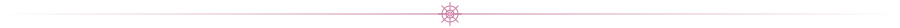

 

<h3 align="center">ABOUT</h3>

Computer Science Engineering student specialising in Artificial Intelligence and Machine Learning. 
I build across computer vision, language models, forecasting and full-stack applications, 
and I aim to learn something new every single day.

<h3 align="center">FOCUS AREAS</h3>

<table align="center">
  <tr>
    <td align="center" width="25%"><b>Computer Vision</b> OpenCV, MediaPipe, real-time recognition</td>
    <td align="center" width="25%"><b>LLMs and NLP</b> RAG, chatbots, responsible AI</td>
    <td align="center" width="25%"><b>Machine Learning</b> Classical models, forecasting, healthcare</td>
    <td align="center" width="25%"><b>Full-Stack Development</b> React, Flask, Streamlit</td>
  </tr>
</table>

<h3 align="center">TECH STACK</h3>

<table align="center">
  <tr>
    <td width="20%" valign="middle"><b>Languages</b></td>
    <td>
      
      
      
      
      
      
    </td>
  </tr>
  <tr>
    <td width="20%" valign="middle"><b>Machine Learning and AI</b></td>
    <td>
      
      
      
      
      
      
      
      
      
    </td>
  </tr>
  <tr>
    <td width="20%" valign="middle"><b>Computer Vision</b></td>
    <td>
      
      
      
      
    </td>
  </tr>
  <tr>
    <td width="20%" valign="middle"><b>Data</b></td>
    <td>
      
      
      
      
      
    </td>
  </tr>
  <tr>
    <td width="20%" valign="middle"><b>Web and Backend</b></td>
    <td>
      
      
      
      
      
      
    </td>
  </tr>
  <tr>
    <td width="20%" valign="middle"><b>Tools</b></td>
    <td>
      
      
      
      
      
    </td>
  </tr>
</table>

<h3 align="center">SELECTED PROJECTS</h3>

<table align="center">
  <tr>
    <td width="33%" valign="top">
      <code>01</code> 
      <a href="https://github.com/muskan-101/diwali-plume"><b>Diwali Plume</b> 
      Featured research project  
      Computer Vision · Air Quality · Forecasting
    </td>
    <td width="33%" valign="top">
      <code>02</code> 
      <b>Serenity Bot</b> 
      Conversational support assistant  
      LLMs · RAG · NLP · Responsible AI
    </td>
    <td width="33%" valign="top">
      <code>03</code> 
      <a href="https://github.com/muskan-101/menstrual-tracker-frontend"><b>Bloom in Every Cycle</b> 
      Women's health technology  
      Machine Learning · Flask · Healthcare Technology
    </td>
  </tr>
  <tr>
    <td width="33%" valign="top">
      <code>04</code> 
      <b>AI Gesture-Controlled Wheelchair</b> 
      Assistive technology  
      Computer Vision · MediaPipe · SVM
    </td>
    <td width="33%" valign="top">
      <code>05</code> 
      <a href="https://github.com/muskan-101/SPENDWISE_FSD"><b>SpendWise</b></a> 
      Financial management application  
      React · Full Stack · Data Processing
    </td>
    <td width="33%" valign="top">
      <code>06</code> 
      <a href="https://github.com/muskan-101/HandwrittenDigit_Recognition"><b>Handwritten Digit Recognition</b> 
      Real-time recognition app  
      OpenCV · SVM · Streamlit
    </td>
  </tr>
</table>

<a href="https://github.com/muskan-101?tab=repositories">View all repositories</a>

<h3 align="center">GITHUB ACTIVITY</h3>

<h3 align="center">CONNECT</h3>

  
  
  

Learning in public, one repository at a time.

